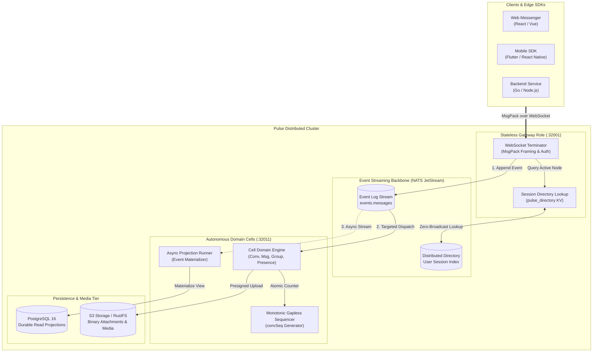

<p align="center">
  
</p>

<p align="center">
  <strong>Ultra-fast, Distributed, Cloud-Native Instant Messaging Platform</strong><br>
  Single binary &bull; Autonomous cell sharding &bull; CQRS & Event Sourcing &bull; Microsecond latency
</p>

<p align="center">
  <a href="https://golang.org"></a>
  <a href="https://nats.io"></a>
  <a href="https://www.postgresql.org"></a>
  <a href="LICENSE"></a>
  <a href="./docs/en/index.md"></a>
</p>

---

Pulse is an enterprise-grade, high-throughput instant messaging engine designed for massive concurrent connections and predictable sub-millisecond latencies. 

Instead of brittle, hard-to-maintain microservice meshes, Pulse employs an **autonomous cell architecture** packaged in a **single binary**. It cleanly decouples connection termination (Gateway) from business logic (Domain Cells) and asynchronous materialization (Projection Runners) via **NATS JetStream** and **PostgreSQL 16**.

---

## Architecture Overview

Pulse replaces legacy microservice topologies with autonomous cells and event-driven streaming:



### Core Processing Paths

1. **Write Path (Command)**: Gateway accepts incoming WebSocket binary frames $\rightarrow$ verifies JWT token $\rightarrow$ appends immutable events into NATS JetStream `events.messages`.
2. **Targeted Routing**: Distributed directory lookup (`pulse_directory` KV) maps recipients to their active gateway nodes $\rightarrow$ eliminates cluster-wide broadcast amplification.
3. **Read Path (Query)**: Asynchronous Projection Runner streams NATS events and materializes PostgreSQL read models. Gapless monotonic ordering (`convSeq`) is enforced via atomic database sequence counters.

---

## Key Highlights

- **Cell-Based Sharding**: Scale horizontally by partitioning users and conversations into independent, fault-isolated cells.
- **CQRS + Event Sourcing**: Append-only event log backed by NATS JetStream with durable projections persisted in PostgreSQL 16.
- **Strict Gapless Ordering**: Atomic DB-backed sequence counters guaranteeing strictly monotonic `convSeq` ordering per conversation without gaps.
- **Targeted Distributed Routing**: Distributed user directory (`pulse_directory`) using NATS KV to route messages directly to active nodes—zero cross-cell broadcast amplification.
- **Seamless Session Handoff**: Stateless WebSocket gateways allow clients to reconnect to any node with zero message loss and instant catch-up sync.
- **Single Binary, Multi-Role**: Deploy as an all-in-one process (`pulse dev`) or independently scale specific roles (`cell`, `gateway`).
- **Clean Extensibility**: Modular extension system (`pkg/extension`) allowing commercial/enterprise plugins to mount cleanly without polluting the open-source core.

---

## Quick Start (Under 60 Seconds)

### Prerequisites

- Go 1.22+
- Docker & Docker Compose v2
- Make

### 1. Start Infrastructure Dependencies

```bash
# Start PostgreSQL 16, NATS JetStream, and RustFS (S3 storage)
docker compose up -d postgres nats rustfs
```

### 2. Build & Apply Migrations

```bash
make deps
make build
make migrate-up
```

### 3. Run Pulse in Dev Mode

```bash
# Starts both cell (domain engine) and gateway (WebSocket termination)
./bin/pulse dev --config configs/dev-localhost.yaml
```

Verify service health:
```bash
curl http://localhost:32011/healthz
```

---

## Quick Smoke Test

```bash
# 1. Initialize Admin Account
TOKEN=$(curl -s -X POST http://localhost:32011/api/v1/admin/init \
  -H "Content-Type: application/json" \
  -d '{"secret":"dev-secret-change-me-in-production-32chars","adminUserID":"admin","adminPassword":"Pulse@Admin1"}' \
  | jq -r .data.adminToken)

# 2. Register a User
curl -X POST http://localhost:32011/api/v1/user/register \
  -H "Authorization: Bearer $TOKEN" \
  -H "Content-Type: application/json" \
  -d '{"userID":"alice","nickname":"Alice","email":"alice@example.com"}'

# 3. Mint Client Token
USER_TOKEN=$(curl -s -X POST http://localhost:32011/api/v1/auth/userToken \
  -H "Authorization: Bearer $TOKEN" \
  -H "Content-Type: application/json" \
  -d '{"userID":"alice","platform":"WEB"}' | jq -r .data.token)

# 4. Connect via WebSocket (using wscat or any client)
wscat -c ws://localhost:32001 -s pulse.protocol.v1.msgpack \
  -H "Authorization: Bearer $USER_TOKEN"
```

---

## Repository Layout

```
pulse/
├── assets/               # Brand assets (logo, icon, vector badges)
├── cmd/pulse/            # Pure OSS single binary entrypoint
├── internal/
│   ├── cell/             # Domain engines (user, conversation, group, message, presence, friend, search, media)
│   ├── gateway/          # WebSocket termination and session lifecycle
│   └── api/              # REST server and standard handlers
├── pkg/
│   ├── app/              # Standard runtime application runner
│   ├── core/             # Public Core contracts (Cell, Service, User)
│   ├── extension/        # Plugin & extension registration interfaces
│   ├── protocol/         # Binary frame codecs & event types
│   └── shared/           # Config, DB, NATS, Auth, Logger, Metrics
├── migrations/           # Single consolidated migration (0001_init.up.sql)
├── configs/              # Dev and production YAML configuration profiles
├── docker-compose.yaml   # Local dev dependencies (Postgres, NATS, RustFS)
└── docs/                 # Documentation (English & Tiếng Việt)
```

---

## Documentation

Comprehensive guides and architecture documentation are available in `docs/`:

- 🇬🇧 **[English Documentation](./docs/en/index.md)** (Default):
  - [Architecture](./docs/en/architecture.md)
  - [Quickstart Guide](./docs/en/quickstart.md)
  - [REST API Reference](./docs/en/api-reference.md)
  - [WebSocket Protocol](./docs/en/websocket-protocol.md)
  - [Configuration](./docs/en/configuration.md)
  - [Contributing](./docs/en/contributing.md)
- 🇻🇳 **[Tài liệu Tiếng Việt](./docs/vi/index.md)**

Production deployment configurations and Helm charts are maintained in [`pulse-deploy`](https://github.com/pulse-workspace/pulse-deploy).

---

## Development & Testing

```bash
# Run unit and integration tests
make test

# Format and lint code
make fmt lint

# Build production binary
make build
```

---

## License

This repository is licensed under the [Apache License, Version 2.0](LICENSE).
