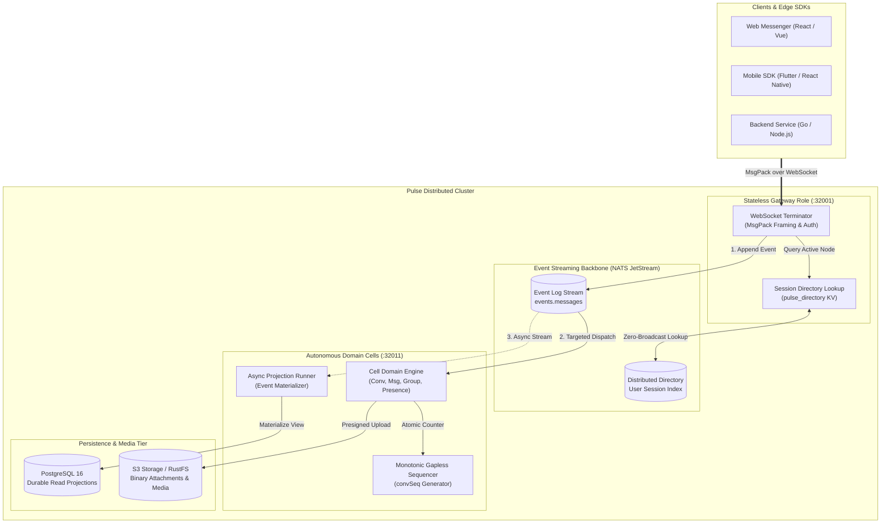

# Pulse Architecture

Pulse is engineered as a **single binary, multi-role** distributed messaging engine. It implements **Command Query Responsibility Segregation (CQRS)** and **Event Sourcing** with **NATS JetStream** as the streaming backbone and **PostgreSQL 16** as the durable projection store.

---

## High-Level Topology

---

## Core Architecture Tenets

### 1. Cell-Based Sharding
Traffic and data are partitioned into autonomous units called **Cells**. Each Cell owns a subset of conversations and users, running its own domain logic independently. A failure in one Cell remains isolated to that Cell without impacting the rest of the cluster.

### 2. CQRS & Event Sourcing
- **Write Path (Command)**: Client actions (e.g. sending a message) are validated and immediately committed as append-only immutable events to NATS JetStream.
- **Read Path (Query)**: Asynchronous projection workers consume events and update PostgreSQL projection tables, which serve read operations with microsecond-level query latencies.

### 3. Strict Monotonic Sequencing (`convSeq`)
Every conversation maintains a strictly increasing, gapless sequence counter in PostgreSQL. Clients track their local sequence number and can detect missing frames, requesting precise incremental catch-ups during reconnections.

### 4. Targeted Routing via Distributed Directory
Pulse eliminates broadcast amplification across the cluster. When routing a message to recipients, the Gateway checks the distributed directory (`pulse_directory` in NATS KeyValue) to identify exactly which cells and gateway nodes host active recipient sessions, publishing directly to targeted NATS subjects.

### 5. Seamless Session Handoff
Gateways are stateless. When a client reconnects (e.g. switching from Wi-Fi to cellular), any available Gateway node can accept the connection, query the NATS session directory, hand off state from the previous gateway, and resume the stream with zero lost messages.

### 6. Media & Object Storage
Pulse offloads binary media payloads (images, audio, video, attachments) from the primary transactional database to S3-compatible object storage via `pkg/shared/s3` and `internal/cell/media`:
- **Direct Streaming / Presigned URLs**: Media downloads use presigned URLs or direct streaming via the media service, preventing high-bandwidth media from congesting the WebSocket gateway.
- **Pluggable Backends**: Compatible with AWS S3, Cloudflare R2, MinIO, or Google Cloud Storage in production.
- **Local Development**: Runs **RustFS** (a lightweight, high-performance S3-compatible storage engine) in `docker-compose.yaml` so developers can run complete media upload/download flows locally without cloud credentials.

