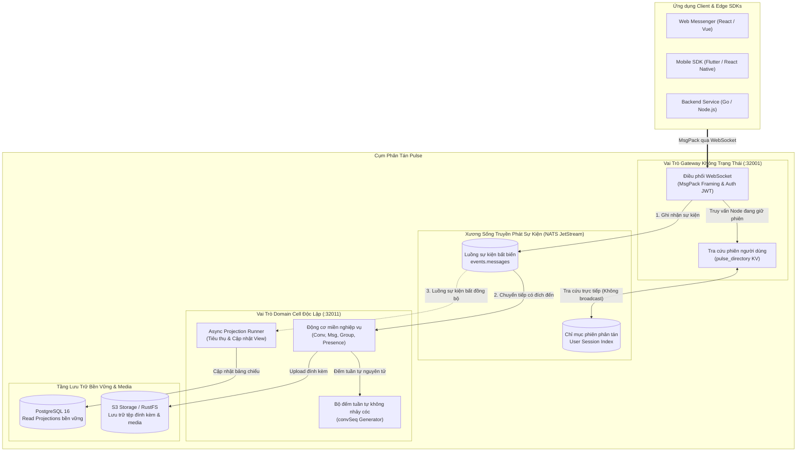

# Kiến trúc Hệ thống Pulse

Pulse được thiết kế theo mô hình **Single Binary, Multi-Role** (một file thực thi duy nhất hỗ trợ nhiều vai trò chạy phân tán). Nền tảng áp dụng mô hình **CQRS (Command Query Responsibility Segregation)** và **Event Sourcing** với **NATS JetStream** làm xương sống truyền phát sự kiện và **PostgreSQL 16** lưu trữ các read-model projection bền vững.

---

## Sơ đồ Tổng quan Cụm Pulse

---

## Các Nguyên tắc Kiến trúc Cốt lõi

### 1. Phân vùng theo Cell (Cell-Based Sharding)
Toàn bộ lưu lượng và dữ liệu được phân chia thành các đơn vị tự trị gọi là **Cell**. Mỗi Cell quản lý một tập hợp người dùng và hội thoại độc lập. Khi xảy ra sự cố tại một Cell, phạm vi ảnh hưởng chỉ giới hạn trong Cell đó, triệt tiêu lỗi lan truyền toàn cụm.

### 2. CQRS & Event Sourcing
- **Luồng Ghi (Command)**: Yêu cầu từ client (ví dụ gửi tin nhắn) được kiểm tra tính hợp lệ và ghi ngay lập tức dưới dạng sự kiện bất biến vào NATS JetStream.
- **Luồng Đọc (Query)**: Các tiến trình Projector bất đồng bộ tiêu thụ sự kiện từ stream và cập nhật các bảng projection trên PostgreSQL, phục vụ các truy vấn đọc với độ trễ microsecond.

### 3. Bộ đếm Tuần tự Nghiêm ngặt (`convSeq`)
Mỗi cuộc trò chuyện duy trì một bộ đếm số thứ tự tăng dần liên tục, không có khoảng cách (`zero-gap`). Thiết bị client lưu trữ `seq` mới nhất đã nhận và có thể phát hiện tin nhắn bị thiếu để đồng bộ bổ sung chính xác khi kết nối lại.

### 4. Định tuyến Hướng đích (Targeted Routing)
Pulse không broadcast toàn bộ tin nhắn ra toàn mạng lưới. Thay vào đó, Gateway tra cứu thư mục phân tán (`pulse_directory` trên NATS KeyValue) để xác định chính xác Cell và Gateway nào đang giữ phiên hoạt động của người nhận, sau đó xuất bản trực tiếp đến NATS subject tương ứng.

### 5. Bàn giao Phiên Mượt mà (Session Handoff)
Các gateway hoàn toàn stateless. Khi người dùng di chuyển hoặc chuyển mạng (từ Wi-Fi sang 4G/5G), kết nối mới có thể gắn vào bất kỳ node Gateway nào. Node mới sẽ tra cứu thư mục, tiếp nhận trạng thái từ gateway cũ và khôi phục luồng dữ liệu mà không làm rơi rớt tin nhắn.

### 6. Lưu trữ Tệp & Đa phương tiện (Media & Object Storage)
Pulse phân tách hoàn toàn các tệp nhị phân dung lượng lớn (hình ảnh, video, âm thanh, tệp đính kèm) ra khỏi cơ sở dữ liệu giao dịch PostgreSQL và đưa vào hệ thống Object Storage chuẩn S3 thông qua `pkg/shared/s3` và `internal/cell/media`:
- **Presigned URLs / Direct Streaming**: Thiết bị client có thể tải tệp trực tiếp thông qua presigned S3 URLs, tránh làm nghẽn băng thông của WebSocket Gateway và luồng tin nhắn văn bản.
- **Tương thích Đa nền tảng**: Hỗ trợ đầy đủ AWS S3, Cloudflare R2, MinIO, Google Cloud Storage khi chạy production.
- **Phát triển Cục bộ với RustFS**: File `docker-compose.yaml` tích hợp sẵn container **RustFS** (S3 server gọn nhẹ, hiệu năng cao viết bằng Rust) giúp kiểm thử trọn vẹn luồng gửi/nhận tệp mà không cần tạo tài khoản cloud thực tế.

